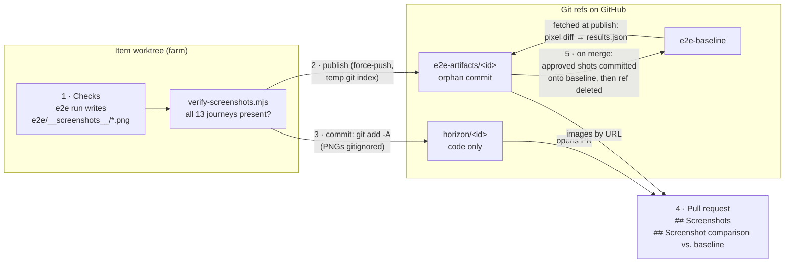
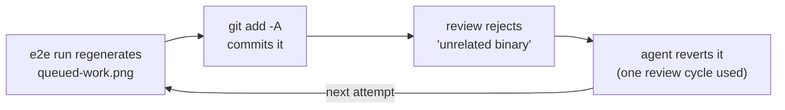

# E2E screenshots — from a test run to the PR and the baseline

Every implement run photographs the UI at 13 points in the e2e journeys, so a
reviewer at the "Accept the code" gate can see what the change looks like, and
what changed visually, without checking out the branch. This doc explains
where those PNGs go and why they **never ride on the code branch**.

## Why not just commit them?

A PNG has no merge strategy. When screenshots were committed with the code, any
two branches that regenerated the same journey's screenshot conflicted, even if
their code didn't (HZ-63). So `e2e/__screenshots__/` is gitignored, and the
pixels travel on their own git refs instead.

## The three refs

| Ref | Holds | Written by | Lifetime |
|---|---|---|---|
| `horizon/<id>` | The item's code. Never screenshots. | `finalize_branch()` in `farm/step_agent.py`, after checks pass | Deleted when the PR merges |
| `e2e-artifacts/<id>` | This item's PNGs, as a single commit with no history | `publish_screenshots()` in `farm/step_agent.py`, force-pushed on every implement run | Deleted when the PR merges or is closed unmerged |
| `e2e-baseline` | The approved shots of every merged item, screen by screen | `promoteBaseline()` in `server/src/github.js`, called from `mergePr()` | Permanent; one commit per merge that promotes a shot |

`<id>` is the lowercased item id, e.g. `e2e-artifacts/hz-143`.

## The pipeline



### 1 · Checks: capture and verify

- Each Playwright journey calls `captureScreenshot(page, name)`
  (`e2e/fixtures/test-base.js`), which writes `e2e/__screenshots__/<name>.png`.
  A failed capture only warns; it never fails the test.
- `e2e/package.json`'s `test` script ends with `node verify-screenshots.mjs`,
  which fails the run if any of the 13 names in `EXPECTED_JOURNEYS` is missing.
  Add a name there when you add a journey that captures a screenshot.
- Checks run **before** anything is committed or pushed ("no green, no push").
  A failed check discards the attempt, so nothing below happens.

### 2 · Publish: `publish_screenshots()`

Once checks pass, the farm builds a commit containing only the PNGs, without
touching the working tree or the real index:

1. Point `GIT_INDEX_FILE` at a temporary index.
2. `git hash-object -w` each PNG, then `git update-index --cacheinfo` it into
   the temp index at `e2e/__screenshots__/<name>.png`.
3. HZ-508: fetch `e2e-baseline` (read only — publish never pushes it) and
   compare each shot by name with its top-level PNGs. A shot missing from the
   baseline is `new`, a baseline shot not captured is `removed`, an identical
   blob is `same`. Every other pair goes to `farm/capture/diff.mjs`, which runs
   `pixelmatch` with a per-pixel `threshold` of 0.1: more than 1% of pixels
   differing (`ratioTolerance` 0.01) is `changed`, anything at or under it is
   `same`. Two sizes are always `changed`, diffed on the larger canvas. The
   repo's `.horizon/screenshots.json` can override both numbers under `diff`.
4. Add `e2e/__screenshots__/results.json` (one row per shot: `name`,
   `status`, `diffRatio`, `diff`, `error`) and a `diff/<name>.png` per
   `changed` shot to the same temp index. A shot whose PNG can't be read is
   `changed` with `error` set and no diff PNG.
5. `git write-tree` → `git commit-tree` (no parent, so an orphan commit).
6. Force-push that commit to `refs/heads/e2e-artifacts/<id>`. The previous
   publish's shots, results and diffs are all replaced.

This is best-effort. A failure is logged and skipped, and the implement step
carries on. The log says `publish_screenshots: pushed N screenshot(s) to …`,
or `no screenshots to publish — skipped` for items whose runs produce none.
If the diff step fails (`farm/capture` not installed — `npm ci` there on the
farm host — a crash, a hang past `DIFF_TIMEOUT_S`, or bad output), the log
says `publish_screenshots: diffs skipped — …` and the shots are pushed without
`results.json`.

### 3 · Commit: `finalize_branch()`

`git add -A`, commit, `git push --force-with-lease` to `horizon/<id>`. Because
`e2e/__screenshots__/` is in `.gitignore`, the PNGs stay out of the commit,
**as long as none of them is already tracked** (see
[the pitfall below](#pitfall-a-tracked-screenshot-defeats-gitignore)).

### 4 · Review: the PR description

`createPrFromBranch()` reads the artifacts ref, never the code branch, and
adds two sections to the PR body, between `<!-- horizon:screenshots:start -->`
and `<!-- horizon:screenshots:end -->`:

- **`## Screenshots`**: one image per PNG, linked by the GitHub contents API's
  `download_url` for `e2e-artifacts/<id>`. The URL names the ref, not a sha,
  so a later implement run's force-push updates the images in place without
  editing the PR.
- **`## Screenshot comparison vs. baseline`**: one row per shot, rendered by
  `screenshotResultsMarkdown()` from the `results.json` the latest publish
  stored (step 2). The server never reads `e2e-baseline` here. With no
  `results.json` the table is omitted.

`createPrFromBranch()` runs after every implement run. When the PR is already
open (a rework), `refreshPrScreenshots()` replaces only the marked section, so
the table always matches the latest publish and text outside the markers is
left alone. A body without markers gets the section appended once.

All of it is "never throw": a 404, bad `results.json` or GitHub hiccup just
drops the section, and a failed refresh leaves the old one.

### 5 · Merge: `promoteBaseline()`

When the "Accept the code" gate merges the PR (squash), `mergePr()`:

1. Deletes `horizon/<id>`.
2. HZ-510: promotes the shots approved at the gate (HZ-509's per-screen
   approvals, read by `screenshots.mergeApprovals()`; an approval counts only
   while the shot is unchanged since). Using the `results.json` on
   `e2e-artifacts/<id>`, it builds one tree on top of the current
   `e2e-baseline` tree:
   - an approved `changed` or `new` shot points at its artifacts blob (reused
     by sha, nothing is uploaded);
   - an approved `removed` shot is deleted, if the baseline still has it;
   - every other baseline path keeps its blob, and an unapproved shot is never
     named. `results.json` and `diff/*` are never promoted.
   An approved shot with no PNG on the artifacts ref (its capture errored) is
   skipped and logged; it keeps its baseline blob and the rest still promote.
3. Commits that tree with the old head as its only parent and moves
   `e2e-baseline` with `force: false`. If the head moved meanwhile (`422`), it
   rebuilds on the new head and retries, up to 3 times, so two merges landing
   together keep each other's shots. With no `e2e-baseline` yet, the first
   promotion creates it with only the approved shots (a parentless commit); a
   lost race with another seed retries on top of it.
4. Deletes `e2e-artifacts/<id>`, only after a successful promotion. With no
   approved shots there is no commit, and the ref is still deleted.

A failed promotion never fails or reverts the merge. It is logged as
`baseline promotion failed for <id>: …` and `e2e-artifacts/<id>` is kept —
but only until the next daily prune (`pruneArtifactRefs()`), which deletes the
refs of merged items. Re-running a failed promotion needs that ref, so it is a
manual job within about 24h; a durable promotion job that retries on its own
is the follow-up if the logs show stale baselines. The baseline only ever
moves on merge, never from a PR branch. Older baselines may still hold a
`results.json` and `diff/` from before HZ-510; publish reads only top-level
PNGs, so they are ignored.

If the PR is **closed unmerged** on GitHub, the item is sent back and
`e2e-artifacts/<id>` is deleted. The next implement attempt republishes it.

## Repos with `.horizon/screenshots.json`: the farm's capture runner (HZ-506)

A repo can instead commit a screenshot config (`.horizon/screenshots.json`,
schema in `farm/screenshots_config.py`, HZ-505). It commits **no capture
code**: one Horizon-owned runner, `farm/screenshot_runner.py` plus the
Playwright worker in `farm/capture/`, captures every repo's screens. It is
versioned with the config schema (the manifest's `runner` field names the
schema version) and is never copied into a repo.

At the implement step, after every check command passes, `run_checks()` (in
the same check slot) runs it:

1. Starts `serve` with bash, in its own process group.
2. Polls `ready` until it answers. `ready` must be an `http://` URL on
   `127.0.0.1` or `localhost`; its origin is the base for every screen's
   `path`.
3. Captures each shot (screen × viewport × theme) under **that shot's own**
   `timeoutMs`. The worker loads the page, waits for network idle (500 ms
   with no request in flight; `EventSource` and WebSocket requests are
   ignored, as they never end), then, if the screen sets `waitFor` (a CSS
   selector, also settable in `defaults`), for that element to be visible
   (HZ-527). All of that waiting counts against `timeoutMs`; the worker has
   no deadline of its own. An overrun kills the worker, marks the shot
   `timeout`, and the next shot gets a fresh worker. A page taller than `maxHeightPx` is cut
   at that height and marked `clipped`. Shots that would start after the
   run's budget (`FARM_CHECK_TIMEOUT_S`) are `skipped`.
4. Writes `<outputDir>/manifest.json`:

   ```json
   {"version": 1, "runner": "farm/screenshot_runner.py@schema-1", "shots": [
     {"screen": "home", "viewport": "desktop", "theme": "light", "status": "ok",
      "durationMs": 812, "png": "home--desktop--light.png", "clipped": false}
   ]}
   ```

   `status` is `ok`, `timeout`, `error` or `skipped`. `png` is relative to
   `outputDir` and `null` unless the shot is `ok`. An `error` entry carries a
   redacted `error` message.
5. Stops `serve`'s whole process group (SIGTERM, then SIGKILL after 5 s) and
   the worker, however the run ended.

**SSE-driven pages need `waitFor`.** Network idle can not see data that
arrives on an open stream, such as Horizon's board on `/api/stream`: set
`waitFor` to an element that only renders once that data is in.

A slow or failing shot does **not** fail the check; the summary says e.g.
`screenshots: 5 ok, 1 timeout`. The slot fails only when nothing can be
captured: `outputDir` is not gitignored (no PNG may reach `main`), the worker
or Chromium is not installed, or `serve` never became ready. The slot's saved
command lines in Admin never run — a repo can not swap in its own runner.

`publish_screenshots()` then pushes the PNGs **and `manifest.json`** from the
configured `outputDir`, under the same `e2e/__screenshots__/` tree path on
`e2e-artifacts/<id>`. `server/src/github.js` lists `.png` files only, so the
manifest rides along without showing in the PR. Repos without a config keep
publishing from `e2e/__screenshots__` until the HZ-511 cutover. HZ-512: a
configured repo also publishes the top-level journey PNGs in
`e2e/__screenshots__` beside its outputDir's (a name in both is the config's
shot), so adopting a config never reads a journey shot as `removed`.

**Login.** Captures never log in: only each screen's `path` is visited. The
key mechanism is HZ-494 (PR #498): the repo's `test_env_file` values. A
`login: true` shot sends each value as a request header named
`X-Horizon-Test-Env-<NAME>` (`_` becomes `-`), to the app's own origin only;
a `login: false` shot sends none. `serve` gets the values in its env when any
shot is `login: true`, so the app can check the header it receives. Every
value is redacted from the log, the manifest and the check output.

**Cookie login (HZ-557).** An app that logs in by cookie sets a top-level
`loginCookies` map from cookie name to test-login variable **name**:

```json
"loginCookies": {"ft_api_key": "FT_E2E_API_KEY", "ft_user_email": "FT_E2E_EMAIL"}
```

It holds names only; the values are read from the repo's `test_env_file` at
run time and never reach the config, the DB, GitHub or a prompt. With
`loginCookies` set, a `login: true` shot sets those cookies for the app's own
origin before the page loads **instead of** sending the
`X-Horizon-Test-Env-*` headers: one login mechanism per repo. A variable that
is unset fails the slot with one line naming it. Browser cookies ignore the
port, so a request to another port on the app's host is re-fetched by the
worker without its `Cookie` header. That re-fetch buffers the response, so an
event stream on a second local port never ends (the app's own streams are
untouched). WebSockets are not re-fetched: keep them on the app's origin.

**Mask (HZ-557).** `mask`, on a screen or in `defaults`, is a list of CSS
selectors whose elements are covered in solid `#FF00FF` in the shot. A
screen's `mask` replaces the one in `defaults`. A selector that matches no
element with a box fails that shot as `mask "<selector>" matched nothing`;
a masked box that is not solid mask colour in the shot fails it as
`mask "<selector>" still visible`. Either way the shot writes no PNG. The
check output cuts each reason at 60 characters, so long selectors end in `…`.

**Host setup.** `farm/run.sh` runs `npm ci` in `farm/capture` when its
`node_modules` is missing or older than its lockfile. `farm/capture` pins
`playwright` to the exact version `e2e/package-lock.json` resolves, so both
share one Chromium build in `~/.cache/ms-playwright` — bump them together.

### Horizon's own login key: `SCREENSHOT_LOGIN_KEY` (HZ-511)

Horizon's repo row points `test_env_file` at a 0600 host file holding one
value, `SCREENSHOT_LOGIN_KEY=<random>` (not `HORIZON_*`: `farm/login_env.py`
reserves that prefix). A `login: true` shot therefore sends
`X-Horizon-Test-Env-SCREENSHOT-LOGIN-KEY`, and `server/src/testEnvLogin.js`
treats a match as the `ADMIN_EMAIL` account on every `/api/*` route and on
`GET /api/auth/me`. No request goes to `/api/auth/login`.

- It works only when the server runs with `HORIZON_TEST_HOOKS=1` and a
  non-empty `SCREENSHOT_LOGIN_KEY`. Production sets neither, so it ignores
  the header.
- The request is labelled `via: 'test-env'`, not a session: it can not pass a
  human gate, even with the PIN, and can not manage API tokens.
- The key is never committed and never logged. A wrong header gets the usual
  `401 login_required`.

### Horizon's own screens (HZ-512)

Horizon's `.horizon/screenshots.json` holds the `layout-*` screens that
replace the layout-only e2e tests (the follow-up removes those tests; the
mapping is `REMOVED_LAYOUT_TESTS` in `farm/tests/test_horizon_screens.py`).
Its outputDir is `e2e/__screenshots__/config`: gitignored, and apart from the
journey shots, because the runner empties outputDir before each capture.

`serve` is `e2e/screenshots/serve.sh`. It builds the UI, seeds a throwaway DB
(`e2e/screenshots/seed.mjs`, rows in `e2e/fixtures/layout-screens-seed.js`),
runs the server in demo mode with `HORIZON_TEST_HOOKS=1` and an empty `HOME`,
and serves the UI with `vite preview` on fixed ports 5480 (UI, `ready`) and
5481 (server), above both e2e port windows. A host-wide `flock` lets one
capture hold the ports at a time; a second waits up to 90 s.

Two captures on one commit are byte-identical because of three seed rules:

- Every timestamp is in 2099. Elapsed lines clamp to `<1m` and activity rows
  read `just now`, whenever the shot is taken.
- Rows at an agent step go in after the server answers, so the boot resume
  never kicks them. Rows seeded first keep the demo items out.
- No shown item has an active step on its tracker page: the step icon pulses
  (`auraPulse`). The activity screen's item is closed for that reason.

**Dark shots.** With no stored theme, the UI follows `prefers-color-scheme`
(`ui/src/theme.js`, and the pre-paint script in `ui/index.html`), so a
`dark` shot's `colorScheme` renders dark. A stored choice still wins.

## Pitfall: a tracked screenshot defeats `.gitignore`

`.gitignore` only affects untracked files. If a PNG under
`e2e/__screenshots__/` was committed before the ignore rule existed (or
force-added), git keeps tracking it, and every e2e run's regenerated copy shows
up as a modification that `git add -A` commits.

That's what trapped HZ-143. Three stale PNGs (`abandon`, `artifact-history`,
`queued-work`) were still tracked on `main`, which caused this loop:



No agent can exit this loop, because the check step regenerates the file on
every attempt. PR #149 fixed it with `git rm --cached` on the three files.

**How to check:** `git ls-files e2e/__screenshots__` must print nothing. If it
prints anything, untrack those files the same way.

## Where to look

| What | File |
|---|---|
| Capture helper | `e2e/fixtures/test-base.js` (`captureScreenshot`) |
| Presence check | `e2e/verify-screenshots.mjs` (`EXPECTED_JOURNEYS`) |
| Ignore rule | `.gitignore` (`e2e/__screenshots__/`) |
| Publish + commit order | `farm/step_agent.py` (`publish_screenshots`, `finalize_branch`) |
| Config-driven capture (HZ-506) | `farm/screenshot_runner.py`, `farm/capture/worker.mjs`, `farm/checks.py` (`_capture_screenshots`) |
| Diff at publish (HZ-508) | `farm/step_agent.py` (`_compute_results`), `farm/capture/diff.mjs`; sample `results.json`: `domain/fixtures/screenshot-results.json` |
| PR body, promotion, cleanup | `server/src/github.js` (`screenshotsMarkdown`, `screenshotResultsMarkdown`, `refreshPrScreenshots`, `createPrFromBranch`, `promoteBaseline`, `mergePr`) |
