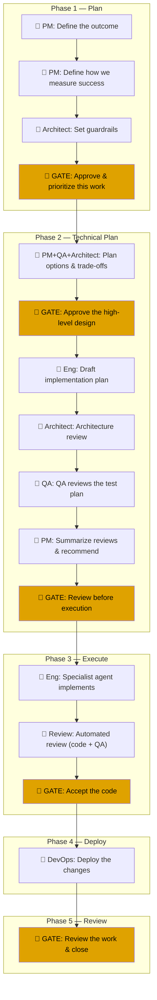

# Workflow — how a task moves from definition to done

Every unit of work in Horizon is a **work item** (usually backed by a GitHub
issue). Every work item follows the exact same fixed sequence of steps —
there is no per-item customization today. That sequence is defined once, in
code, at `domain/steps.json`, as five **phases** containing sixteen
**steps**. Every consumer — server, UI, farm and the e2e suite — reads a
generated binding of that one file; see [`domain/README.md`](../domain/README.md). This doc explains that sequence for a reader who has never seen
the codebase.

## The two kinds of step

- 🤖 **Agent step** — the server hands the step to an AI agent (via the farm,
  see [`docs/architecture.md`](architecture.md)) and waits for it to report
  back. No human action is required to *start* it.
- 🚦 **Gate step** — work stops here until a human clicks Approve (or
  Reject) in the UI. Every gate in the current lifecycle is `required`.

## The full sequence

Yellow boxes are gates (human required); the rest run automatically once
their turn comes up. This mirrors `phases` and `steps` in
`domain/steps.json` exactly — that file is the source of truth, and this
diagram will drift if it changes without this doc being updated.

## Which agent does what

Every agent step names an agent by its `agent` field in `domain/steps.json`.
The role's presentation (label, initials, colour) is a separate, hand-owned
concern: `server/src/agentTokens.js` server-side, `ui/src/domain/agentTokens.js`
in the UI.

| Agent | Role |
| --- | --- |
| **PM** | Defines outcome/success criteria, synthesizes review summaries |
| **Architect** | Sets guardrails, reviews architecture of a plan |
| **Ensemble** | PM + QA + Architect together, for the options/trade-offs step |
| **Eng** | Drafts the implementation plan, then implements the code |
| **QA** | Reviews whether the test plan is sufficient |
| **Review** | Automated code + QA review after implementation |
| **DevOps** | Deploys the change |
| **Ask reviewer** | Reviews each ask a step raised, for fit, overlap and shape (not a step) |

The **ask reviewer** (HZ-729) is not a lifecycle step. When a step's reply
carries asks, the server sends each one, once, to a reviewer on a provider
other than the ask's author: Muse by default, or the project's
`ask_review_provider`. If that provider is unavailable, the ask waits for
review; it never falls back to the author's provider. The reviewer only
reviews: its `accept`, `amend` or `escalate` verdict and reasons are stored
on the ask and shown in the item snapshot. See
[`docs/agent-architecture.md`](agent-architecture.md#ask-review--an-independent-check-on-a-different-provider-hz-729).

The table above names the *label* a step shows in the UI; it does not say
which *process* actually executes it. Two steps that look like separate
agent roles (0/1/9 as PM, 2 as Architect) share one long-lived PM process,
while every other agent step gets a fresh, short-lived process per run:

| Step index | Label | Executes as |
| --- | --- | --- |
| 0 | Define the outcome | PM session |
| 1 | Define how we measure success | PM session |
| 2 | Set guardrails | PM session |
| 4 | Plan options & trade-offs (pros / cons) | fresh agent |
| 6 | Draft implementation plan | fresh agent |
| 7 | Architecture review | fresh agent |
| 8 | QA reviews the test plan | fresh agent |
| 9 | Summarize reviews & recommend | PM session |
| 11 | Specialist agent implements | fresh agent |
| 12 | Automated review (code + QA) | fresh agent |
| 14 | Deploy the changes | fresh agent |

(Gates — 3, 5, 10, 13, 15 — are covered above; they get no agent at all.)
Sourced from `domain/steps.json`, `farm/farmd.py`'s lane routing and
`farm/step_agent.py`'s `STEP_CONFIG`. See
[`docs/agent-architecture.md`](agent-architecture.md) for why that PM/fresh
split exists, why the PM's long-lived session makes steps 0/1/2/9
non-reproducible, and how a step's AI provider is actually chosen.

## What "current step" and "done" mean

Each work item stores a single number, `cursor` — its index into the 16-step
`STEPS` array. `curStep(item)` (`domain/js/lifecycle.js`) looks up
`STEPS[item.cursor]` to find what's next; an item is closed
(`isClosed`, same file) once `cursor >= STEPS.length`, i.e. it has
passed the final "Review the work & close" gate. There is no other "done"
state — paused and blocked (below) are both independent of, and do not
change, the cursor.

## A concrete walk-through

1. A human (or a synced GitHub issue) creates a work item. Its `cursor`
   starts at `0` — step 1, "Define the outcome," a PM agent step.
2. The orchestrator (`server/src/orchestrator.js`) sees the item is
   `runnable()` and dispatches step 0 to the farm. The PM agent runs, writes
   its output back via `POST /api/farm/steps/:runId/complete`, and the
   orchestrator advances `cursor` to `1`.
3. Steps 1 and 2 repeat the same agent-dispatch pattern.
4. `cursor` reaches step 3, a gate. The orchestrator stops — no agent is
   dispatched. The item sits here until a human opens the UI and approves.
5. On approval, `cursor` advances to `4` and Phase 2 begins the same way:
   agent steps run automatically, gate steps wait for a human.
6. This repeats through Phase 3 (Execute — the actual code gets written and
   reviewed), Phase 4 (Deploy — a real GitHub Release gets published and the
   host redeploys, see [`docs/architecture.md`](architecture.md)), and
   Phase 5 (a final human review and close).
7. Once `cursor` passes index 15 (the last step), `isClosed(item)` is `true`
   and the item is done.

## Asks

A step's reply may carry **asks**: complete drafts of work it wants filed
(HZ-728), each reviewed once by the ask reviewer (HZ-729). The owner acts on
them (HZ-730):

- **Blocking asks** are work the item needs first. They show prominently: a
  banner on the item page ("This item needs “…” filed first") and a
  **Blocking asks** section at the top of the Approvals drawer. They count
  towards the Pending approvals number.
- **Soft asks** are suggested follow-ups. They show quietly, under
  **Suggested follow-ups** on the item, and on the project-wide
  **Follow-ups** page (`/follow-ups`, linked from the top bar), for triage in
  batches.
- Each ask shows its draft (title, repo, outcome, success metric,
  guardrails), the step that raised it by name, why, and the reviewer's
  verdict and reasons, or **Not reviewed yet**. When the verdict is `amend`
  the card shows the reviewer's amended draft, and that is what gets filed.

Two actions, both needing a browser session and the gate PIN (an API token
cannot file or dismiss):

- **File it** files the draft as a new item on the repo the ask names, and
  only if that repo is connected to the asking item's project. The draft is
  re-checked first: no token, secret or host path, and the issue body holds
  the plan text only. For a blocking ask the new item becomes a dependency of
  the asking item, which then waits for it (see the Dependencies section of
  `README.md`). A soft ask adds no dependency. File it waits for the review:
  an ask with no verdict yet is refused; an `escalate` verdict is the
  owner's call. A second File it files nothing new and links nothing new.
- **Dismiss** needs a reason. The ask closes, and the reason is queued as
  feedback for the asking item's next agent step, addressed to the agent of
  the step that raised it and naming that step.

A PM split (an ask of kind `split`) stays read-only: it is filed at its own
gate, as before.

With Autopilot `on`, the Caretaker never files or dismisses an ask (HZ-793):
every ask waits for the owner's File it or Dismiss. Once an ask's review
comes back, it pings the owner once with the verdict. With Autopilot off,
the owner decides. See `farm/roles/caretaker.md`.

## Three things that can interrupt "ever-forward"

- **Paused.** A human can pause an item at any point (a UI action, tracked
  separately from `cursor`). A paused item's steps simply don't get
  dispatched until resumed.
- **Blocked (dependencies, see `README.md`'s Dependencies section).** A work
  item can declare it depends on another. `holdingBlockers`
  (`domain/js/lifecycle.js`) returns the blockers that hold the item at its
  current step, and the orchestrator's `runnable()` refuses to dispatch
  while any do. HZ-467: a change item runs steps 0–10 freely; from implement
  on, it waits until each blocker has merged to main (`merged_at`) or
  closed. Task and Plan items wait on every step until each blocker has
  closed. A blocker that is abandoned (soft-deleted, not
  closed) still blocks — `isBlockedByAbandoned` flags this case distinctly
  so it doesn't silently look like ordinary in-progress work.
- **An open blocking ask (HZ-731).** No gate is approved by Autopilot while
  the item has an open blocking ask; the owner is pinged instead. And before
  Implement (a Task's Execute) starts, every blocking ask must be dismissed,
  or filed with its item merged or closed. Until then the item waits, shown
  as Blocked, and its page names the ask or the item it waits for
  (`askStartHold` in `domain/js/lifecycle.js`). Soft asks never hold
  anything.

All three are independent of the phase/step sequence itself — they gate *whether*
the next step runs, not *which* step is next.

See [`docs/architecture.md`](architecture.md) for how each step's agent
dispatch physically works (server → farm → tmux → agent → server).
